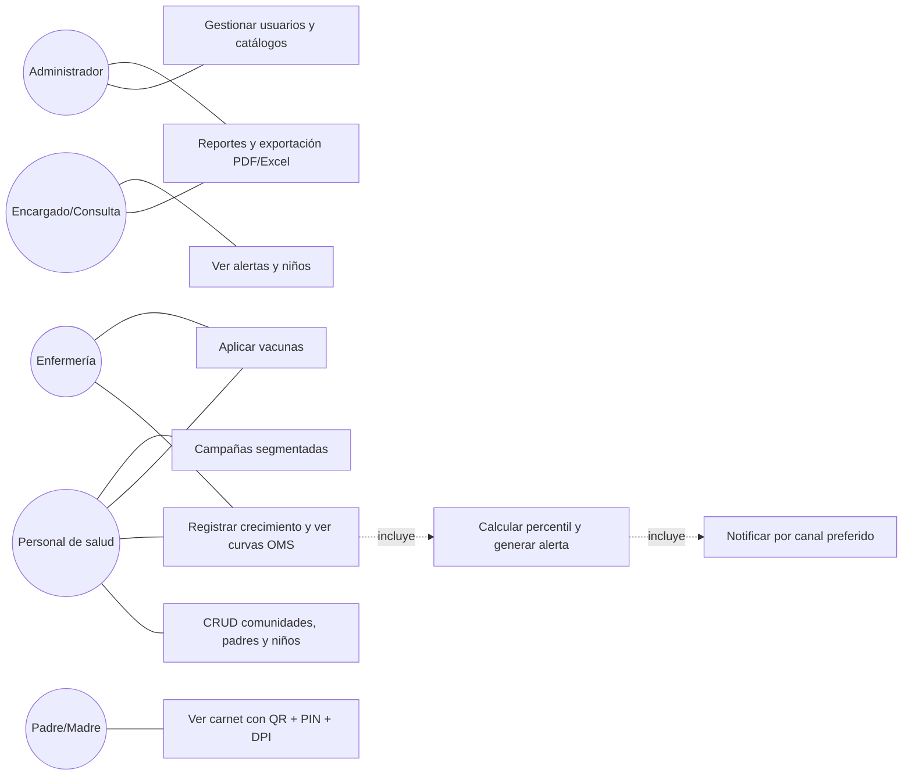
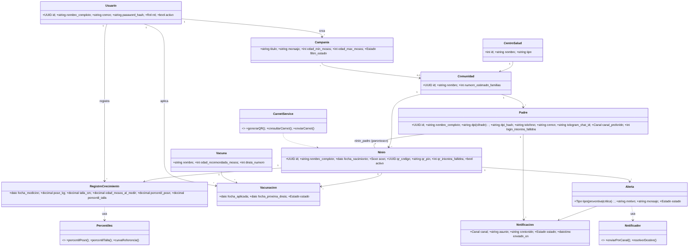
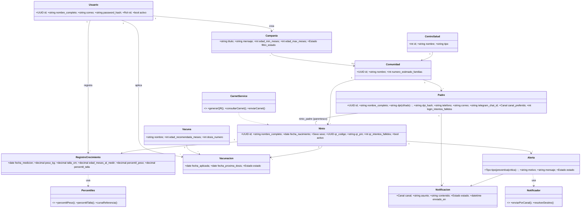
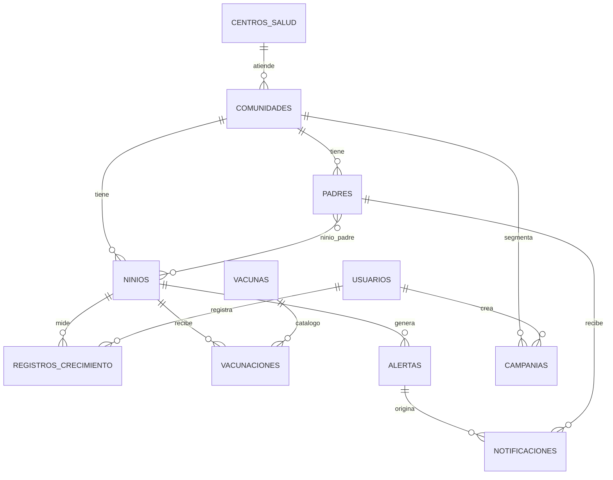
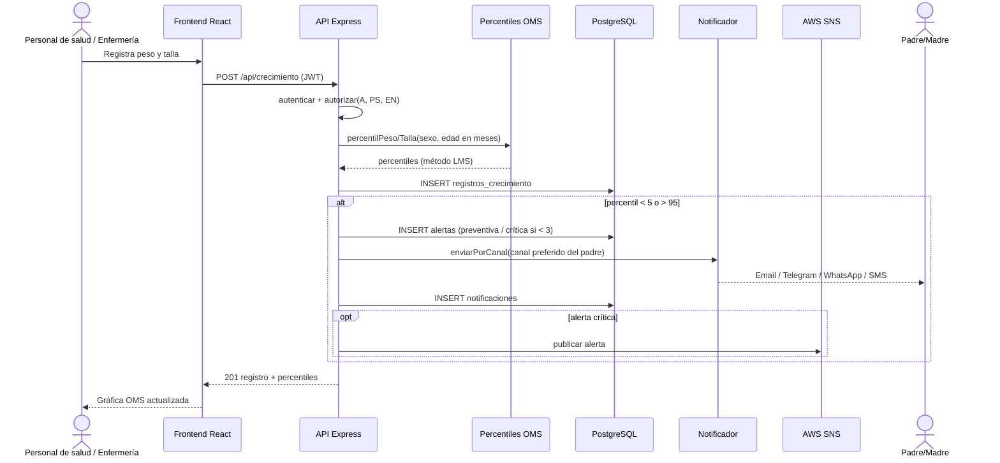
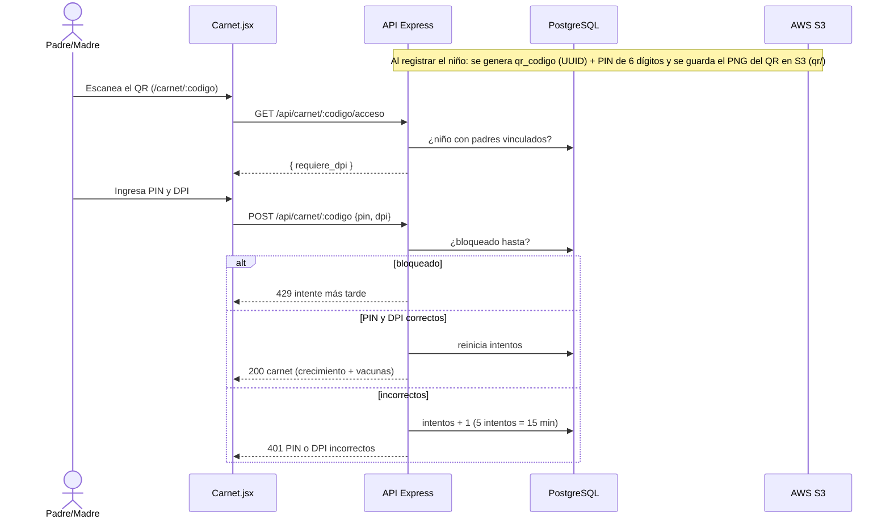
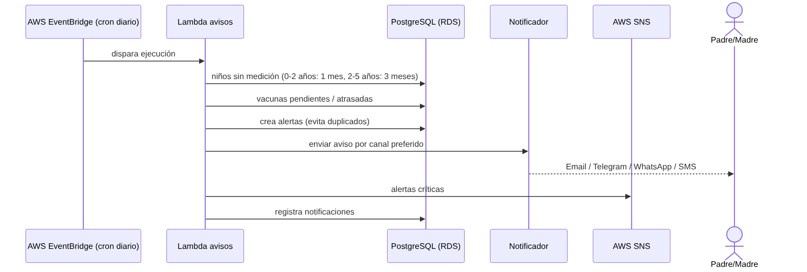
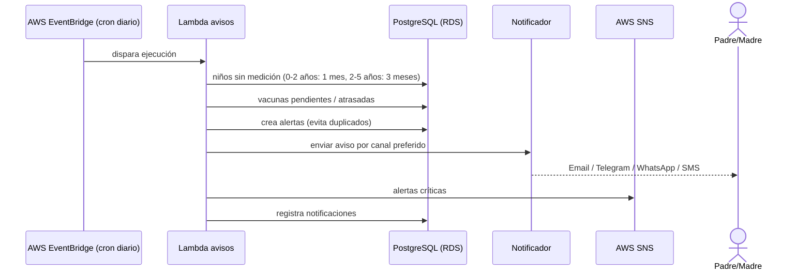
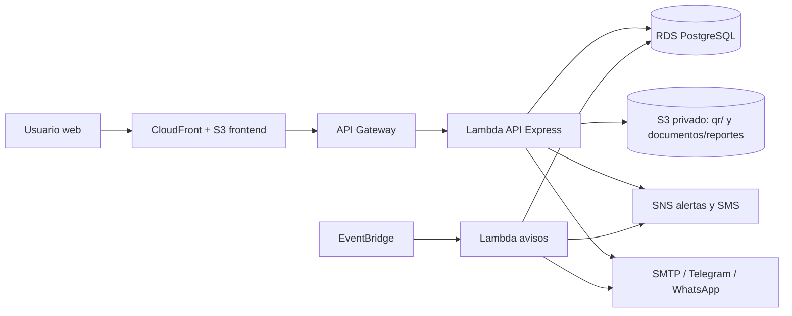

# Diagramas UML de SISVAC

Fuentes Mermaid en `docs/uml/*.mmd` y imágenes PNG renderizadas junto a ellas. GitHub renderiza los bloques de abajo directamente.

## Casos de uso

## Diagrama de clases

## Modelo entidad-relación

## Secuencia – registrar medición, alerta y notificación

## Secuencia – acceso al carnet digital (QR + PIN + DPI)

## Secuencia – avisos automáticos programados

## Arquitectura AWS

